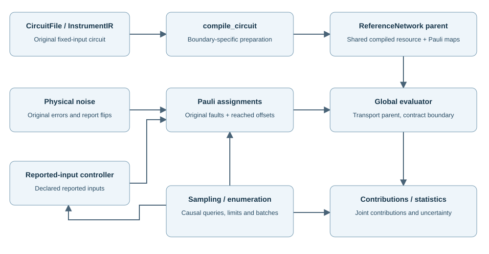

# How it works

This page gives the whole picture: what happens between loading a circuit file and reading a result,
how the work is split between Python and C++, and where everything lives in the repository.
The pages that follow describe the [compilation and sampling lifecycle](compiler.md),
the [operation-level API](operations.md) and the [exact value types](values.md) in more detail.

## The pipeline

1. **Parse.** The circuit file becomes a `CircuitFile`: an instruction graph with exact rational
   noise arguments, source locations, expanded `REPEAT` blocks, detector expressions and the
   dependency graph of every `CONTROL` instruction. Parsing checks causal references and decoder
   bindings but calls no decoder.
2. **Compose the task.** The circuit's `POSTSELECT` acceptance condition and the task's outputs
   and error definition are attached. An ideal state and a terminal recovery are parsed with the
   same grammar and composed onto the selected output wires. External decoder calls are classified after exact symbolic simplification:
   affine feedback becomes coherent record wires, everything else becomes a fixed template
   with Pauli-controlled corrections whose control bits are supplied at run time.
3. **Compile.** The whole fixed-input instrument is written as an amplitude over binary path
   variables with Clifford and non-Clifford phases. Global elimination removes every Clifford
   constraint and every record that nothing reads. The remaining non-Clifford phase is expanded
   into a stabilizer decomposition. One *reference network* is prepared for each query the task
   needs: acceptance (output traced), fidelity (target attached), and, for tasks with external
   decoders, guarded noise or requested records, a sampling network with selection and output traced.
   The resource report in `inspect` describes these networks. They are prepared once.
4. **Sample.** For each draw, the native sampler draws faults from the declared noise
   (or the importance proposal) and walks the circuit in causal order. Before each decoder call
   the history sampler draws the reported bits that decoder needs from the sampling network:
   `affine_support` (the default) proposes them from a linear family that contains every possible
   history and reweights the draw exactly, and `exact_marginal` draws each bit from its exact
   conditional probability. The sampler then calls the decoder and transports
   faults and decisions as Pauli updates onto the prepared networks. The draw's acceptance and
   error masses are then exact contractions of the terminal networks. Contributions and weights
   accumulate into the estimates, standard errors and efficiency diagnostics.
   **Enumerate** replaces the random draw by an exhaustive walk over low-weight fault patterns
   and all reachable decoder histories, summing the same exact contributions.

No quantum state is ever propagated through the circuit in time, and nothing is recompiled
between draws: Pauli faults and decoder decisions change the assignment to a prepared network, not its structure.

## Python and C++

Only the user interface is Python. The package `magna` provides the file functions
(`load_circuit`, `compile_circuit`, `run`, `enumerate_errors`, `compare_samplers`),
result serialisation and the registry that connects your decoder functions;
`magna.operations` provides the operation-level classes.
Everything algorithmic is in the C++ extension:
parsing, control analysis, compilation, Pauli transport, noise generation, causal scheduling,
sampling, enumeration, exact arithmetic and statistics.
Your decoder stays a Python function; the kernel schedules it and converts its bits into assignments.

| Native directory | Responsibility |
|---|---|
| `foundation/` | Exact scalars, stabilizer algebra, numeric conversion, known measurement parities, resource-limit errors and fixed-resolution noise thresholds |
| `compile/` | Parsing, control analysis, task and terminal composition, lowering to the fixed instrument, fault transport maps |
| `evaluate/` | Query compilation, reference networks, phase elimination and contraction |
| `runtime/` | Noise, causal scheduling, sampling, enumeration, history efficiency and statistics |
| `bindings/` | Conversion between Python and the native owners |

## Repository map

| Path | Contents |
|---|---|
| `core/magna/` | The installed package: Python interface and the `native/` C++ sources |
| `tests/core/` | Protocol-independent regression tests and installed-wheel acceptance tests |
| `tests/fixtures/` | Small circuits used by the tutorial and the tests |
| `examples/` | Self-contained protocol tasks, one directory each, run with `scripts/run_task.py` |
| `scripts/` | Build, test, documentation, task-runner and decoder-download entry points |
| `docs/software/` | This manual |

The kernel contains no protocol-specific code: no circuit generators, no stored answers,
no experiment-tuned proposals. Protocols enter as circuit files and decoders as registered functions.

## Guarantees and limits

- Per-draw accepted and error masses are exact; statistical error comes only from the sampled faults and decoder inputs.
- Resources depend on the output and the non-Clifford structure left after elimination, not directly on qubit count. Preparation that exceeds a budget fails explicitly; nothing is approximated.
- Inputs are fixed. The simulator does not evaluate open-input processes.
- Rotation axes that do not form one commuting layer are supported by phase-copy ancillas; the compiler keeps the largest commuting layer on shared coordinates. See [compilation](compiler.md#noncommuting-rotation-axes).
